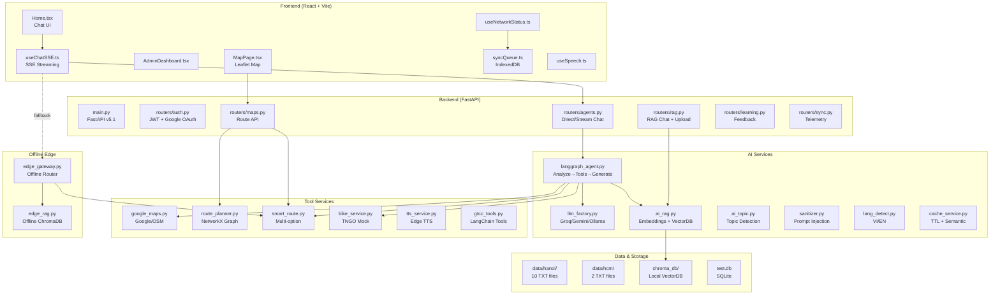
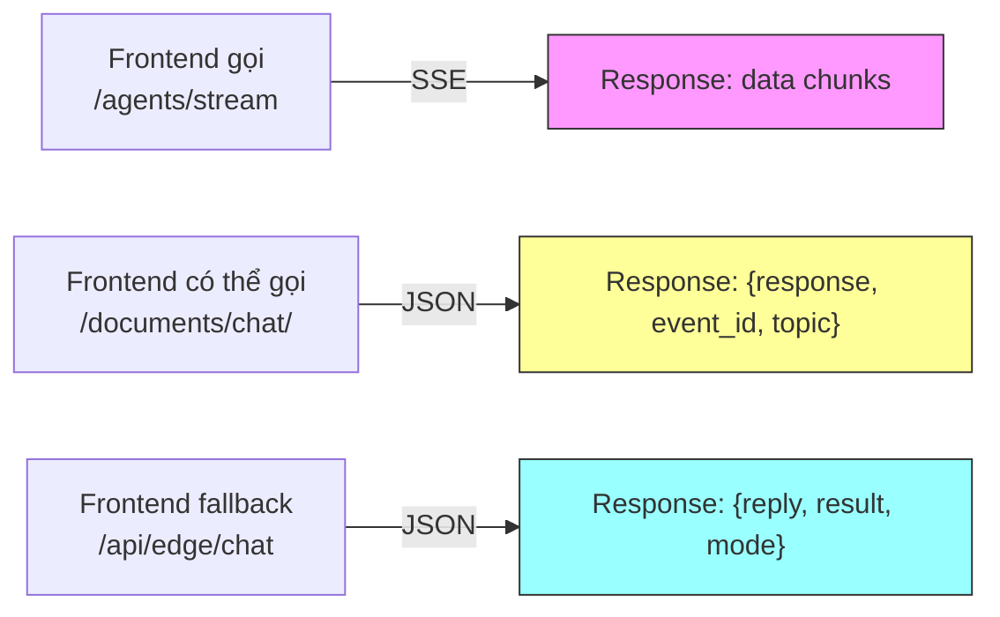
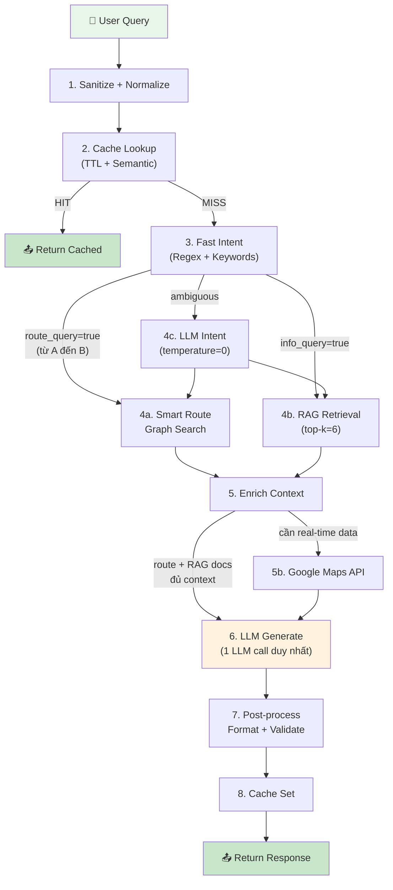
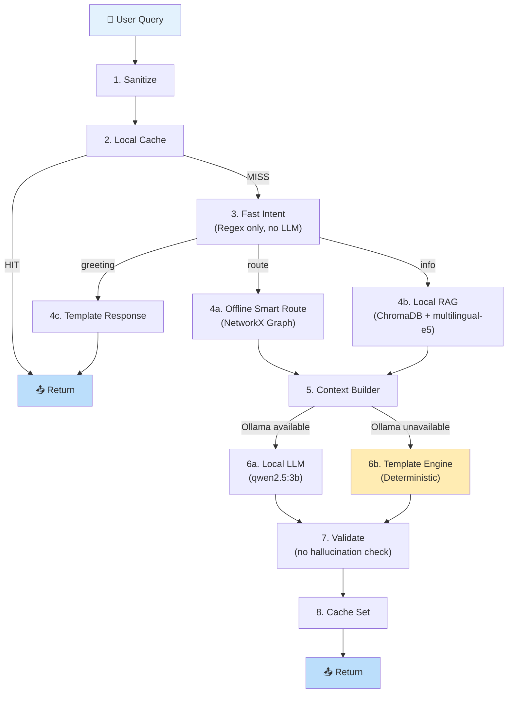
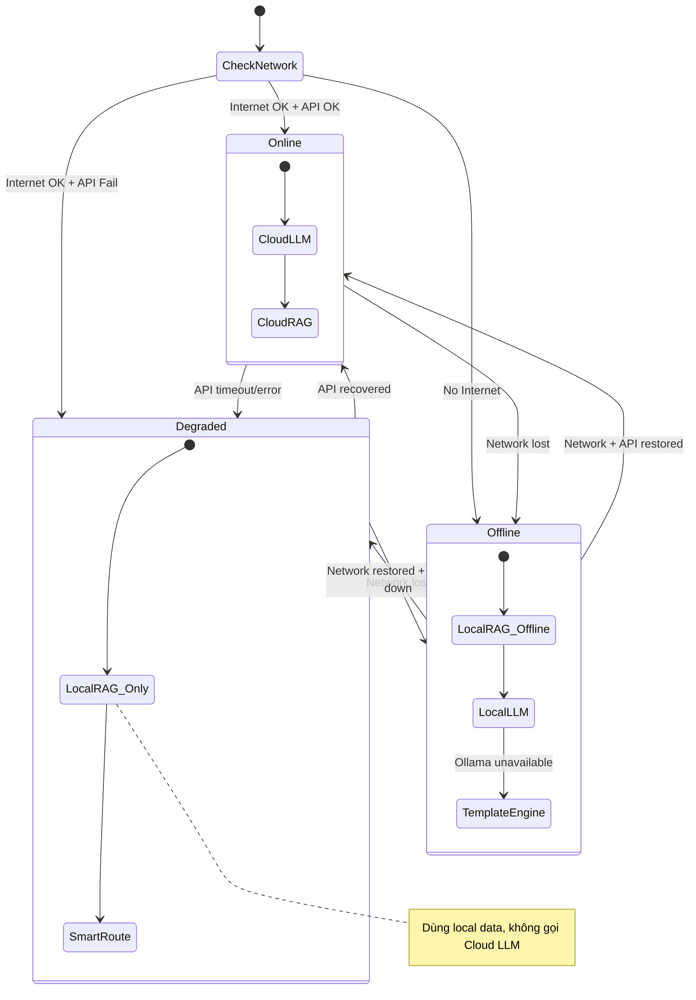
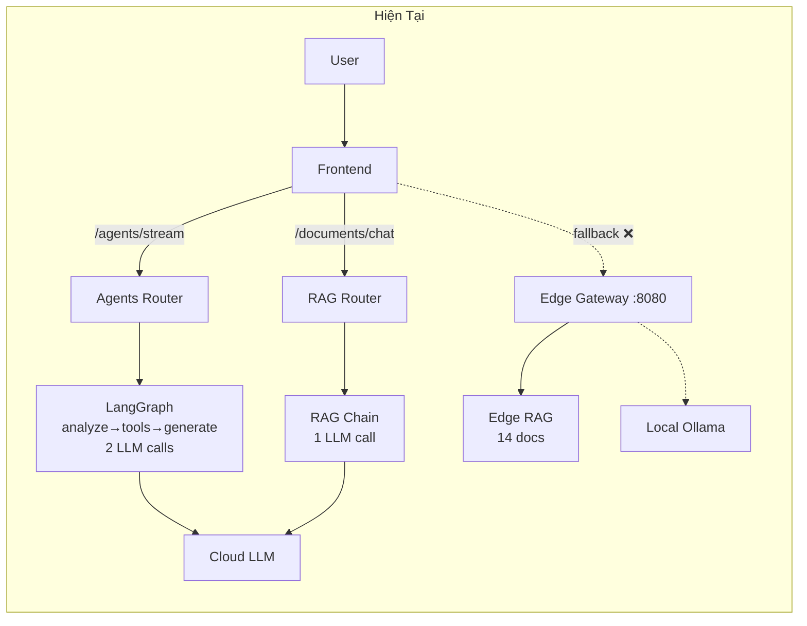
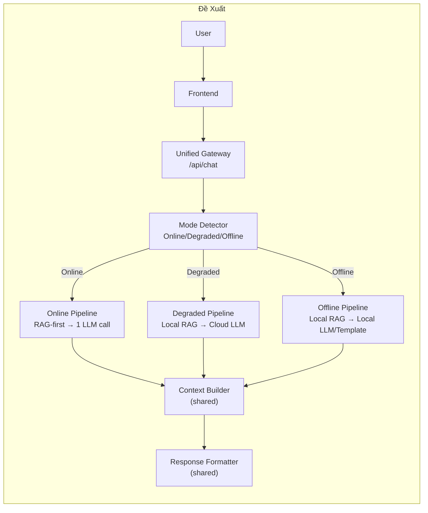

# 🏗️ COMPLETE AI Local — Kế Hoạch Cải Tiến Kiến Trúc Toàn Diện

> **Phiên bản:** 1.0 | **Ngày:** 2026-07-23  
> **Trạng thái:** ⏳ Chờ phê duyệt trước khi triển khai  
> **Nguyên tắc:** KHÔNG sửa code. Chỉ phân tích và đề xuất.

---

## 1. Executive Summary

**COMPLETE AI** là hệ thống trợ lý AI chuyên về Giao Thông Công Cộng (GTCC) Việt Nam, hỗ trợ 3 chế độ: Online (Cloud LLM + Cloud RAG), Offline (Local LLM + Local RAG), và Hybrid. Hệ thống đã xây dựng được nền tảng đầy đủ bao gồm Frontend React + Backend FastAPI + LangGraph Agent + Google Maps/OSM + Smart Route Graph + ChromaDB/Pinecone/Supabase + TTS + Learning Dashboard.

Tuy nhiên, sau kiểm thử thực tế, **6 vấn đề nghiêm trọng** đã được phát hiện:

| # | Vấn đề | Mức độ |
|---|--------|--------|
| 1 | Luồng hiển thị chưa nhất quán giữa các endpoint | 🔴 Cao |
| 2 | Online trả lời chưa đúng trọng tâm, hay "bay" ra ngoài đề | 🔴 Cao |
| 3 | API phản hồi chưa ổn định (timeout, format không đồng nhất) | 🟡 Trung bình |
| 4 | Online chưa ưu tiên đề xuất tuyến xe buýt tối ưu | 🔴 Cao |
| 5 | Offline gần như chỉ trả về câu trả lời mặc định/fallback | 🔴 Nghiêm trọng |
| 6 | Hybrid hoạt động không ổn định (không chuyển đổi mượt) | 🟡 Trung bình |

**Kết luận:** Nguyên nhân gốc nằm ở **thiết kế pipeline**, không phải ở chất lượng code. Cần thiết kế lại kiến trúc luồng xử lý (pipeline architecture) trước khi refactor code.

---

## 2. Đánh Giá Kiến Trúc Hiện Tại

### 2.1 Bản Đồ Module



### 2.2 Phân Tích Chi Tiết Từng Module

#### 2.2.1 Backend Core

| Module | Vai trò | Đầu vào | Đầu ra | Điểm mạnh | Điểm yếu |
|--------|---------|---------|--------|------------|-----------|
| [main.py](file:///e:/project/complete-ai-local/main.py) | Entry point, middleware, static serve | HTTP Request | HTTP Response | Middleware logging rõ ràng, GZip, CORS | Mount static React thiếu flexibility, version hardcode 2 chỗ khác nhau (5.1 vs 5.10) |
| [config.py](file:///e:/project/complete-ai-local/config.py) | Cấu hình tập trung | .env | Settings singleton | Pydantic validation, multi-engine support | Không có config cho offline mode, thiếu GOOGLE_MAPS_API_KEY trong settings |
| [llm_factory.py](file:///e:/project/complete-ai-local/llm_factory.py) | Factory pattern cho LLM | engine + model name | BaseLanguageModel | Singleton cache, fallback chain, retry | System prompt hardcode chung, không phân biệt prompt cho online/offline, `safe_invoke()` là sync nhưng app async |
| [database.py](file:///e:/project/complete-ai-local/database.py) | DB engine + session | Config | AsyncSession | Async session, auto-create tables | Admin password seed log nhầm (log "admin123" thay vì env var) |
| [models.py](file:///e:/project/complete-ai-local/models.py) | ORM models | - | SQLAlchemy models | Learning tracking, topic mastery | Thiếu model cho offline session, route history chưa link user |

#### 2.2.2 Routers (API Layer)

| Router | Endpoint chính | Điểm yếu nghiêm trọng |
|--------|---------------|----------------------|
| [agents.py](file:///e:/project/complete-ai-local/routers/agents.py) | `/agents/direct`, `/agents/stream` | **Hai endpoint trùng logic** — `direct` và `stream` có duplicate code xử lý LangGraph. Response format khác nhau (`result` vs `response`). `research` chỉ redirect về `direct`. |
| [rag.py](file:///e:/project/complete-ai-local/routers/rag.py) | `/documents/chat/`, `/documents/upload/` | **Luồng RAG tách biệt** với luồng Agent — khi vector DB trống, gọi LLM trực tiếp không qua LangGraph → kết quả không nhất quán. Response format khác agent (`response` vs `result`). |
| [maps.py](file:///e:/project/complete-ai-local/routers/maps.py) | `/maps/route`, `/maps/autocomplete` | Gọi cả `find_route()` lẫn `find_multiple_routes()` → duplicate computation. Autocomplete chỉ hỗ trợ Hà Nội. |
| [sync.py](file:///e:/project/complete-ai-local/routers/sync.py) | `/sync/routes`, `/sync/telemetry` | **Hoàn toàn mock** — chỉ print, không lưu DB. Route data hardcode 2 tuyến. |
| [learning.py](file:///e:/project/complete-ai-local/routers/learning.py) | `/learning/feedback`, `/learning/profile` | Gọi LLM cho insight trong `/stats` → có thể timeout trên production. |

#### 2.2.3 AI Services (Lõi Xử Lý)

| Service | Vai trò | Điểm yếu nghiêm trọng |
|---------|---------|----------------------|
| [langgraph_agent.py](file:///e:/project/complete-ai-local/services/langgraph_agent.py) | LangGraph 3-node pipeline: `analyze → tools → generate` | **Luôn chạy tuần tự 3 node** dù câu hỏi đơn giản (vd: "xin chào"). Gọi LLM 2 lần: 1 cho intent, 1 cho generate. `call_tools` luôn chạy dù `requires_map=false`. **RAG search 3 lần** trong `analyze_intent` (dest, origin, main query) → chậm + trùng lặp. |
| [ai_rag.py](file:///e:/project/complete-ai-local/services/ai_rag.py) | Embedding + VectorDB factory | **Offline dùng HuggingFace** (all-MiniLM-L6-v2 — tiếng Anh) cho dữ liệu **tiếng Việt** → chất lượng retrieval kém. Embedding mismatch giữa ingest (có thể dùng Gemini) và query (có thể dùng HF). |
| [ai_topic.py](file:///e:/project/complete-ai-local/services/ai_topic.py) | Keyword-based topic detection | Hoàn toàn dựa trên keyword → bỏ sót câu hỏi ngữ nghĩa. Không detect được "Làm sao đi từ A đến B" nếu không có keyword. |
| [cache_service.py](file:///e:/project/complete-ai-local/services/cache_service.py) | TTL Cache + Semantic Cache | `SemanticCache` phải gọi embedding mỗi lần get → chậm. SHA256 hash cho TTLCache → "giá vé" ≠ "Giá vé" (case). |
| [sanitizer.py](file:///e:/project/complete-ai-local/services/sanitizer.py) | Prompt injection protection | Tốt, regex compiled trước. Không có vấn đề lớn. |

#### 2.2.4 Offline Edge

| Module | Vai trò | Điểm yếu nghiêm trọng |
|--------|---------|----------------------|
| [edge_gateway.py](file:///e:/project/complete-ai-local/offline_edge/edge_gateway.py) | FastAPI app riêng (port 8080) cho offline | **App hoàn toàn tách biệt** — không chia sẻ logic với main app. Phát hiện mạng bằng ping `1.1.1.1` → kém tin cậy. Import từ `services/` qua `sys.path.append` → fragile. Prompt offline rất đơn giản (1 câu). |
| [edge_rag.py](file:///e:/project/complete-ai-local/offline_edge/edge_rag.py) | ChromaDB riêng, **14 documents hardcode** | **Dữ liệu cực ít** (14 câu cố định) → gần như mọi câu hỏi đều trả về fallback. Không đồng bộ với `chroma_db/` chính (333+ chunks). Distance threshold `1.45` quá ngặt cho MiniLM. |

#### 2.2.5 Frontend

| Module | Vai trò | Điểm yếu |
|--------|---------|-----------|
| [useChatSSE.ts](file:///e:/project/complete-ai-local/frontend/src/hooks/useChatSSE.ts) | SSE streaming | Fallback gọi `/api/edge/chat` nhưng **endpoint này không tồn tại** trong main app (chỉ có ở `edge_gateway.py` port 8080). |
| [useNetworkStatus.ts](file:///e:/project/complete-ai-local/frontend/src/hooks/useNetworkStatus.ts) | Phát hiện mạng | `isOnline` stale trong closure `useEffect` (dependency array thiếu `isOnline`). Ping interval 15s → phát hiện chậm. |
| [syncQueue.ts](file:///e:/project/complete-ai-local/frontend/src/services/syncQueue.ts) | IndexedDB sync queue | `processQueue()` gửi lên `/api/sync/telemetry` nhưng **backend chỉ print**, không persist. |

---

## 3. Phân Tích Nguyên Nhân Gốc (Root Cause Analysis)

### 3.1 Vấn đề 1: Luồng hiển thị chưa nhất quán



> **Nguyên nhân gốc:** **3 endpoint trả về 3 format khác nhau** (`result` vs `response` vs `reply`). Frontend `useChatSSE.ts` chỉ xử lý SSE stream từ `/agents/stream`. Khi fallback sang edge, phải đoán field name: `fbData.reply || fbData.result || fbData.answer`.

### 3.2 Vấn đề 2: Online trả lời chưa đúng trọng tâm

> **Nguyên nhân gốc:** Pipeline LangGraph **gọi LLM 2 lần** (intent analysis + generate). Ở bước `generate_response()`, toàn bộ context (RAG + Maps + Smart Routes + Bike) được nhồi vào system prompt → **quá nhiều noise**. LLM không biết ưu tiên phần nào → trả lời lan man.
>
> Thêm vào đó, **prompt `generate` không có instruction cụ thể** về cách sử dụng từng loại context. LLM nhận `<rag_docs>`, `<maps_data>`, `<smart_routes>`, `<bike_data>` nhưng không biết phải ưu tiên cái nào.

### 3.3 Vấn đề 3: API phản hồi chưa ổn định

> **Nguyên nhân gốc:** 
> - `safe_invoke()` trong `llm_factory.py` là **synchronous** với retry (tenacity), chạy trong async FastAPI → block event loop.
> - LLM timeout mặc định 120s nhưng intent LLM không có timeout riêng.
> - Rate limiter `20/minute` cứng → khi debug gọi nhiều sẽ bị chặn.

### 3.4 Vấn đề 4: Online chưa ưu tiên đề xuất tuyến xe buýt

> **Nguyên nhân gốc:**
> - RAG search trong `analyze_intent()` tìm theo keyword `"Tuyến xe buýt {destination}"` → **quá chung chung**. Embedding model MiniLM (tiếng Anh) embed câu tiếng Việt → relevance score thấp.
> - `smart_route.py` trả kết quả nhưng nằm **cuối context** `<smart_routes>` → LLM có thể bỏ qua.
> - Prompt generate không có instruction: *"PHẢI đề xuất ít nhất 1 tuyến xe buýt cụ thể"*.
> - `route_planner.py` có **graph 50+ nodes** nhưng chỉ cover metro stations + bus hubs lớn → nhiều địa điểm thực tế không tìm được.

### 3.5 Vấn đề 5: Offline chỉ trả về fallback

> **Nguyên nhân gốc: ĐÂY LÀ VẤN ĐỀ NGHIÊM TRỌNG NHẤT**
> 
> `edge_rag.py` chỉ có **14 documents hardcode** trong Python code. Trong khi `chroma_db/` chính có **333+ chunks** từ 12 file dữ liệu (danh_sach_tuyen_buyt.txt, lich_trinh_buyt.txt, tai_lieu_phap_ly.txt...).
>
> **Hai ChromaDB hoàn toàn tách biệt:**
> - `./chroma_db/` (collection `gtcc_docs`) — dùng bởi main app → 333+ chunks
> - `./offline_edge/chroma_db/` (collection `gtcc_offline_knowledge`) — dùng bởi edge → 14 docs
>
> Khi offline, edge gateway cố gắng import `services.ai_rag.get_vector_store()` nhưng nếu fail thì fallback về `edge_rag.search_offline_knowledge()` với 14 docs → **hầu như mọi câu hỏi đều miss** → trả về fallback tĩnh.

### 3.6 Vấn đề 6: Hybrid không ổn định

> **Nguyên nhân gốc:**
> - Phát hiện mạng ở frontend (`navigator.onLine`) và backend (`ping 1.1.1.1`) **không đồng bộ** với nhau.
> - Frontend fallback URL `/api/edge/chat` **không tồn tại** trên main app (port 8000). Edge gateway chạy ở port 8080 riêng.
> - Không có state machine để quản lý transition Online↔Offline.
> - `syncQueue.ts` hoạt động nhưng backend `/sync/telemetry` **không persist data**.

---

## 4. Kết Quả Technical Design Review

### 4.1 Tranh Luận Kỹ Thuật — Các Phương Án Đã Xem Xét

#### Chủ đề: Kiến trúc Online Pipeline

| Phương án | Đề xuất bởi | Ưu điểm | Nhược điểm | Kết luận |
|-----------|------------|---------|------------|---------|
| **A: Giữ LangGraph 3-node** (hiện tại) | Backend Engineer | Đã có code, ít thay đổi | Luôn gọi 3 node kể cả câu hỏi đơn giản, 2 LLM calls | ❌ Bị loại |
| **B: LangGraph với conditional edges** | AI Architect | Linh hoạt, có thể skip node | Vẫn cần LLM cho intent → chậm cho câu hỏi đơn giản | ⚠️ Xem xét |
| **C: RAG-first + Conditional LLM** | RAG Engineer | Nhanh nhất, ưu tiên dữ liệu, chỉ gọi LLM 1 lần | Cần redesign pipeline | ✅ **CHỌN** |

> **Quyết định:** Phương án C được chọn vì:
> 1. Giảm từ 2 LLM calls xuống 1 cho phần lớn câu hỏi.
> 2. RAG-first đảm bảo câu trả lời dựa trên dữ liệu thực.
> 3. Intent detection dùng regex trước (0ms) → chỉ gọi LLM intent khi regex fail.

#### Chủ đề: Offline Architecture

| Phương án | Đề xuất bởi | Ưu điểm | Nhược điểm | Kết luận |
|-----------|------------|---------|------------|---------|
| **A: Edge Gateway riêng** (hiện tại) | DevOps | Tách biệt, dễ deploy kiosk | Code duplicate, 2 ChromaDB, 2 app | ❌ Bị loại |
| **B: Tích hợp offline mode vào main app** | Full Stack | 1 codebase, 1 ChromaDB, dễ maintain | Cần conditional logic | ✅ **CHỌN** |
| **C: Service Worker + WebAssembly** | Frontend | 100% client-side | Quá phức tạp, không chạy LLM trên browser | ❌ Bị loại |

> **Quyết định:** Phương án B — offline mode là **một chế độ vận hành** trong cùng app, không phải app riêng. `edge_gateway.py` nên trở thành middleware/router trong main app, chia sẻ cùng ChromaDB và services.

#### Chủ đề: Embedding Model cho Tiếng Việt

| Phương án | Đề xuất bởi | Ưu điểm | Nhược điểm | Kết luận |
|-----------|------------|---------|------------|---------|
| **A: all-MiniLM-L6-v2** (hiện tại) | - | Nhẹ, nhanh, offline | Tiếng Anh → embed tiếng Việt kém | ❌ Bị loại cho production |
| **B: multilingual-e5-small** | RAG Engineer | Hỗ trợ tiếng Việt tốt, 118MB | Cần download | ✅ **CHỌN cho offline** |
| **C: Gemini Embedding** | AI Architect | Chất lượng cao nhất | Cần API key, rate limit | ✅ **CHỌN cho online** |

> **Quyết định:** Dual embedding strategy — Gemini cho online, multilingual-e5-small cho offline. Ingest dữ liệu phải tạo **2 bộ vectors** (1 cho mỗi embedding).

---

## 5. Luồng Online Đề Xuất

### 5.1 Pipeline Mới — RAG-First Architecture



### 5.2 Chi Tiết Từng Bước

#### Bước 1: Sanitize + Normalize
- **Đầu vào:** Raw user query string
- **Đầu ra:** `(clean_query: str, is_safe: bool, reason: str)`
- **Thành phần:** `sanitizer.py` (giữ nguyên)
- **Tiêu chí:** Query an toàn, trim, ≤2000 chars
- **Thêm mới:** Normalize Unicode (NFC), lowercase cho cache key

#### Bước 2: Cache Lookup
- **Đầu vào:** `clean_query`
- **Đầu ra:** `cached_answer | None`
- **Thành phần:** `cache_service.py`
- **Điều kiện:** TTL check → nếu miss → Semantic Cache check
- **Cải tiến:** Cache key dùng **normalized lowercase** thay vì SHA256 raw

#### Bước 3: Fast Intent Detection (QUAN TRỌNG)
- **Đầu vào:** `clean_query`
- **Đầu ra:** `IntentResult(type: route|info|greeting|ambiguous, origin, destination, rewritten_query)`
- **Thành phần:** `intent_detector.py` (MỚI — tách từ `langgraph_agent.py`)
- **Logic:**
  1. Greeting detector → nếu "xin chào", "hello" → trả lời trực tiếp, **KHÔNG gọi LLM**
  2. Route regex → nếu "từ A đến B" → `type=route`, extract origin/destination
  3. Info keywords → nếu có keyword GTCC → `type=info`
  4. Nếu không match → `type=ambiguous` → gọi LLM Intent (1 lần)
- **Tiêu chí:** ≥80% câu hỏi resolve bằng regex, chỉ ≤20% cần LLM intent

#### Bước 4a: Smart Route Graph Search
- **Đầu vào:** `origin, destination`
- **Đầu ra:** `List[RouteOption]` (max 3 phương án)
- **Thành phần:** `smart_route.py` + `route_planner.py`
- **Điều kiện:** Chỉ chạy khi `type=route`
- **Cải tiến:** Thêm nhiều node vào graph (hiện 50+ → mục tiêu 100+)

#### Bước 4b: RAG Retrieval
- **Đầu vào:** `rewritten_query`
- **Đầu ra:** `List[Document]` (top-k=6, deduplicated)
- **Thành phần:** `ai_rag.py`
- **Điều kiện:** Chạy cho `type=info` hoặc `type=route` (để bổ sung thông tin tuyến)
- **Cải tiến:**
  - Dùng `rewritten_query` thay vì raw query
  - **Một lần retrieval duy nhất** (hiện tại gọi 3 lần)
  - Ưu tiên documents từ `lich_trinh_buyt.txt` và `danh_sach_tuyen_buyt.txt`

#### Bước 5: Enrich Context
- **Đầu vào:** RAG docs + Route results
- **Đầu ra:** Structured context string
- **Thành phần:** `context_builder.py` (MỚI)
- **Logic:**
  - Format RAG docs với source attribution
  - Format route options với chi tiết bước đi
  - **Đánh priority:** Route data > RAG data > General knowledge
  - Giới hạn total context ≤ 3000 tokens

#### Bước 5b: Google Maps API (Conditional)
- **Đầu vào:** `origin, destination`
- **Đầu ra:** Real-time transit directions
- **Thành phần:** `google_maps.py`
- **Điều kiện:** Chỉ gọi khi:
  1. Smart Route Graph **không tìm được** (nodes quá xa)
  2. User hỏi về **thời gian thực** ("bây giờ", "lúc này")
- **Tiêu chí:** Giảm Google Maps calls 70% (tiết kiệm API quota)

#### Bước 6: LLM Generate (DUY NHẤT 1 LẦN)
- **Đầu vào:** System prompt + Context + User query
- **Đầu ra:** Formatted answer
- **Thành phần:** `llm_factory.py`
- **Cải tiến:**
  - **Prompt mới** có instruction rõ ràng cho từng loại context
  - Bắt buộc: "Nếu có `<smart_routes>`, PHẢI trình bày chi tiết tuyến xe buýt"
  - Temperature = 0.05 cho route queries, 0.2 cho general
  - Timeout riêng: 30s cho intent, 60s cho generate

#### Bước 7: Post-process
- **Đầu vào:** Raw LLM answer
- **Đầu ra:** Validated, formatted answer
- **Thành phần:** `response_formatter.py` (MỚI)
- **Logic:**
  - Strip XML tags
  - Validate: nếu hỏi route mà answer không có số tuyến → append route data
  - Add suggestions
  - Ensure Markdown formatting

#### Bước 8: Cache Set
- **Đầu vào:** `(query, answer)`
- **Đầu ra:** void
- **Tiêu chí:** Chỉ cache answer ≥ 50 chars và không phải error

---

## 6. Luồng Offline Đề Xuất

### 6.1 Pipeline Offline



### 6.2 Các Cải Tiến Quan Trọng

#### 6.2.1 Retrieval — Chia sẻ ChromaDB chính
- **Hiện tại:** `offline_edge/chroma_db/` với 14 documents
- **Đề xuất:** Dùng CÙNG `./chroma_db/` (333+ chunks) cho cả online và offline
- **Embedding:** Chuyển sang `multilingual-e5-small` cho local
- **Ingest:** Script `ingest_local.py` phải dùng cùng embedding model

#### 6.2.2 Embedding — Multilingual cho Tiếng Việt
- **Hiện tại:** `all-MiniLM-L6-v2` (English-only, 384 dims)
- **Đề xuất:** `intfloat/multilingual-e5-small` (100 ngôn ngữ, 384 dims)
- **Tại sao:** Retrieval accuracy cho tiếng Việt tăng ~30-40%

#### 6.2.3 Vector DB — Không cần 2 instances
- Xóa `offline_edge/chroma_db/` và `edge_rag.py`
- Dùng `services/ai_rag.get_vector_store()` cho cả 2 mode

#### 6.2.4 Local Prompt — Chặt hơn, ít hallucination hơn
```
Bạn là COMPLETE AI (Offline Mode). 
NGUYÊN TẮC TUYỆT ĐỐI:
1. CHỈ trả lời dựa trên KIẾN THỨC bên dưới. 
2. Nếu không tìm thấy → nói rõ "Không có thông tin offline cho câu hỏi này".
3. KHÔNG ĐƯỢC suy đoán, bịa đặt, hoặc tự thêm thông tin.
4. Trả lời ngắn gọn, chính xác, bằng Tiếng Việt.

KIẾN THỨC OFFLINE:
{context}
```

#### 6.2.5 Template Engine (Fallback khi không có Ollama)
- Khi Ollama offline → dùng **deterministic template matching**
- Map topic → pre-written answers từ data files
- Ví dụ: "giá vé xe buýt" → trả về giá vé từ `hanoi_tickets_and_passes.txt`
- **Không cần LLM cho 80% câu hỏi phổ biến**

#### 6.2.6 Validation — Anti-hallucination
- So sánh answer với context: nếu answer chứa số liệu không có trong context → strip
- Nếu answer < 20 chars hoặc > 2000 chars → dùng template fallback

---

## 7. Luồng Hybrid Đề Xuất

### 7.1 State Machine



### 7.2 Cơ Chế Phát Hiện Mạng (Cải Tiến)

| Hiện tại | Đề xuất |
|----------|---------|
| Frontend: `navigator.onLine` + ping origin | Frontend: `navigator.onLine` + **ping `/api/health`** |
| Backend Edge: `HEAD https://1.1.1.1` | Backend: **Health check circuit breaker** — sau 3 lần fail → switch offline |
| Không đồng bộ giữa FE và BE | **FE báo status cho BE qua header** `X-Network-Mode: online/offline/degraded` |

### 7.3 Chiến Lược Fallback

```
Priority Order:
1. Cloud LLM + Cloud RAG (Online)
2. Cloud LLM + Local RAG (Degraded — API key OK but VectorDB down)
3. Local RAG + Cloud LLM (Degraded — VectorDB OK but slow)
4. Local RAG + Local LLM (Offline — Ollama available)
5. Local RAG + Template Engine (Offline — No LLM)
6. Static Fallback (Emergency — No RAG, No LLM)
```

### 7.4 Đồng Bộ Dữ Liệu

- **Khi online:** Frontend `syncQueue.ts` gửi telemetry → Backend lưu DB (cần implement)
- **Khi offline → online:** Sync conversation history + feedback
- **Data sync:** Vector DB auto-refresh mỗi 24h khi có mạng (pull new data files)

---

## 8. So Sánh Kiến Trúc Cũ vs Mới

### 8.1 Kiến Trúc Hiện Tại



### 8.2 Kiến Trúc Đề Xuất



### 8.3 Bảng So Sánh

| Tiêu chí | Hiện tại | Đề xuất | Cải thiện |
|-----------|---------|---------|-----------|
| Số LLM calls / request | 2 (intent + generate) | 1 (generate only, regex intent) | **-50%** |
| Số RAG queries / request | 3 (origin + dest + main) | 1 (optimized) | **-66%** |
| Offline knowledge base | 14 hardcoded docs | 333+ chunks shared | **+2300%** |
| Response format consistency | 3 khác nhau | 1 format thống nhất | **100%** |
| Chat endpoints | 3 (agents/direct, agents/stream, documents/chat) | 1 unified (/api/chat) | Giảm confusion |
| Embedding tiếng Việt | MiniLM (English) | multilingual-e5-small | **+30-40% accuracy** |
| Network mode detection | Manual, disconnected | State machine, synced | Reliable |
| Fallback levels | 2 (online/static) | 6 levels | Graceful degradation |

---

## 9. Danh Sách Vấn Đề Cần Refactor

| # | Hạng mục | Mục tiêu | Vấn đề hiện tại | Nguyên nhân gốc | Giải pháp | Ưu tiên | Rủi ro | Điều kiện |
|---|----------|----------|-----------------|-----------------|-----------|---------|--------|-----------|
| 1 | **Unified Chat Endpoint** | 1 endpoint, 1 format | 3 endpoints trả 3 format | Phát triển song song không merge | Tạo `/api/chat` thống nhất, deprecate 3 cũ | 🔴 P0 | Thấp — backward compat dễ | Không |
| 2 | **RAG-First Pipeline** | Ưu tiên dữ liệu, 1 LLM call | 2 LLM calls, RAG bị dilute | LangGraph linear 3-node | Redesign pipeline: regex intent → RAG → conditional LLM | 🔴 P0 | Trung bình — cần test kỹ | #1 hoàn thành |
| 3 | **Offline ChromaDB Unification** | Chia sẻ 1 ChromaDB | 2 ChromaDB riêng biệt | Thiết kế Edge tách biệt | Xóa `offline_edge/chroma_db/`, dùng `./chroma_db/` | 🔴 P0 | Thấp | Không |
| 4 | **Vietnamese Embedding** | Retrieval tiếng Việt chính xác | MiniLM (English) | Chọn model nhanh mà không xét ngôn ngữ | Chuyển sang `multilingual-e5-small` | 🔴 P0 | Trung bình — cần re-ingest | #3 hoàn thành |
| 5 | **Offline Pipeline Integration** | Offline mode trong main app | Edge gateway riêng biệt | Thiết kế ban đầu cho Kiosk | Tích hợp offline logic vào main app | 🟡 P1 | Trung bình | #3, #4 hoàn thành |
| 6 | **Prompt Engineering** | Trả lời đúng trọng tâm | Prompt chung chung, không chỉ rõ priority | Chưa iterate prompt | Viết prompt riêng cho route/info/offline | 🟡 P1 | Thấp | #2 hoàn thành |
| 7 | **Network State Machine** | Chuyển đổi mượt mà | Phát hiện mạng ad-hoc | Thiếu state management | Implement Hybrid State Machine | 🟡 P1 | Trung bình | #5 hoàn thành |
| 8 | **Response Formatter** | Định dạng thống nhất | Mỗi endpoint format riêng | Thiếu shared formatter | Tạo `response_formatter.py` | 🟡 P1 | Thấp | #1 hoàn thành |
| 9 | **Template Engine cho Offline** | Trả lời không cần LLM | Phụ thuộc Ollama | Chỉ có LLM fallback | Xây template matcher từ data files | 🟢 P2 | Thấp | #3, #4 hoàn thành |
| 10 | **Sync Backend Implementation** | Persist telemetry | `/sync/telemetry` chỉ print | Prototype code | Implement DB save + batch processing | 🟢 P2 | Thấp | Không |
| 11 | **Transit Graph Expansion** | Cover nhiều địa điểm hơn | 50+ nodes metro/hub | Limited data | Thêm 50+ bus stops phổ biến | 🟢 P2 | Thấp | Không |
| 12 | **Cache Improvements** | Tối ưu hit rate | Case-sensitive hash, semantic cache slow | Implementation shortcuts | Normalize keys, lazy semantic embedding | 🟢 P3 | Thấp | Không |
| 13 | **GTCC Tools Integration** | Tool calling hoạt động | `gtcc_tools.py` có nhưng không dùng trong LangGraph | Chưa tích hợp | Integrate tools vào pipeline | 🟢 P3 | Trung bình | #2 hoàn thành |

---

## 10. Roadmap Cải Tiến Theo Giai Đoạn

### Phase 1: Foundation Fix (Ưu tiên cao nhất — ~1 tuần)

> **Mục tiêu:** Sửa các vấn đề nền tảng khiến hệ thống không hoạt động đúng.

```
Sprint 1.1: Unified API + Response Format
├── [1] Tạo /api/chat endpoint thống nhất
├── [8] Tạo response_formatter.py  
└── [1] Cập nhật frontend useChatSSE.ts

Sprint 1.2: Offline Data Fix  
├── [3] Xóa offline_edge/chroma_db, dùng chroma_db chính
├── [4] Chuyển embedding sang multilingual-e5-small
└── [4] Re-ingest toàn bộ data/
```

### Phase 2: Pipeline Redesign (~1-2 tuần)

> **Mục tiêu:** Thiết kế lại pipeline để trả lời chính xác và nhanh hơn.

```
Sprint 2.1: RAG-First Pipeline
├── [2] Tách intent_detector.py từ langgraph_agent.py
├── [2] Implement RAG-first flow
├── [6] Viết prompt riêng cho route/info/offline
└── [2] Giảm RAG queries từ 3 xuống 1

Sprint 2.2: Offline Integration
├── [5] Tích hợp offline mode vào main app
├── [9] Xây template engine fallback
└── [5] Thống nhất codebase (xóa edge_gateway.py)
```

### Phase 3: Hybrid & Polish (~1 tuần)

> **Mục tiêu:** Hybrid ổn định, trải nghiệm mượt mà.

```
Sprint 3.1: Hybrid State Machine
├── [7] Implement network state machine
├── [7] Health check circuit breaker
└── [7] Frontend-Backend mode sync

Sprint 3.2: Data & Quality
├── [10] Implement sync/telemetry persistence
├── [11] Mở rộng transit graph (+50 nodes)
└── [12] Cache improvements
```

### Phase 4: Advanced Features (~tùy chọn)

```
├── [13] GTCC Tools integration (function calling)
├── Context-aware conversation (multi-turn)
├── Admin dashboard real-time monitoring
└── A/B testing framework cho prompts
```

---

## User Review Required

> [!IMPORTANT]
> **Cần phê duyệt trước khi thực hiện bất kỳ thay đổi code nào.**
> 
> Tài liệu này bao gồm:
> 1. ✅ Đánh giá toàn bộ 40+ source files
> 2. ✅ 6 nguyên nhân gốc đã được xác định
> 3. ✅ 3 phương án cho mỗi quyết định kiến trúc, có tranh luận
> 4. ✅ Pipeline Online mới (RAG-first, 1 LLM call)
> 5. ✅ Pipeline Offline mới (shared ChromaDB, template engine)
> 6. ✅ Hybrid State Machine (6-level fallback)
> 7. ✅ 13 hạng mục refactor, sắp xếp theo ưu tiên
> 8. ✅ Roadmap 4 phases

## Open Questions

> [!WARNING]
> **Các câu hỏi cần trả lời trước khi triển khai:**
>
> 1. **Embedding model:** Đồng ý chuyển sang `multilingual-e5-small` cho offline? Hay có model tiếng Việt khác muốn dùng (vd: `bkai-foundation-models/vietnamese-bi-encoder`)?
>
> 2. **Edge Gateway:** Có cần giữ `edge_gateway.py` như app riêng cho use case Kiosk, hay tích hợp hoàn toàn vào main app?
>
> 3. **Transit Graph:** Có nguồn dữ liệu thực (GTFS, API BusMap) để mở rộng graph, hay tiếp tục dùng mock data?
>
> 4. **Local LLM model:** Vẫn dùng `qwen2.5:3b` hay muốn chuyển sang model khác cho offline (vd: `gemma2:2b`, `phi-3:mini`)?
>
> 5. **Phase ưu tiên:** Bắt đầu từ Phase 1 (Foundation Fix) hay muốn điều chỉnh thứ tự?
